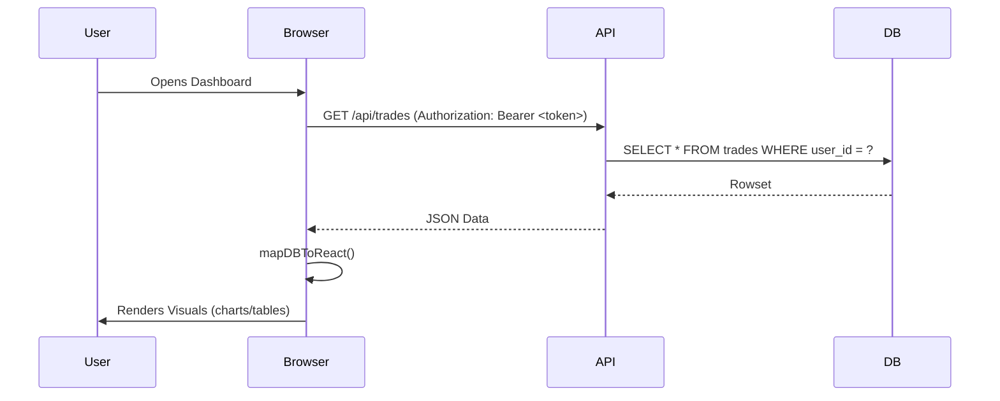
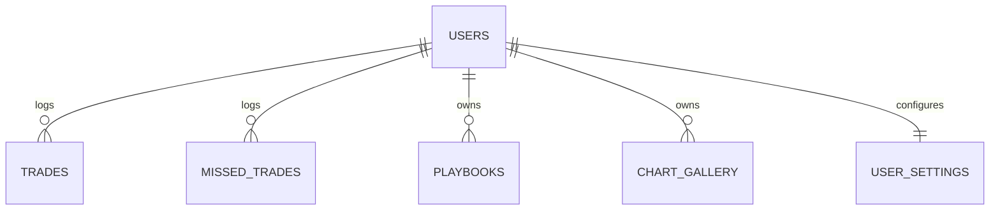

# 🏗️ System Architecture

> **Project:** Trading Journal Pro · **Last updated:** 2026-11-20 · **Status:** 🟢 Stable

---

## Tech Stack

| Layer | Technology | Version | Purpose |
| --- | --- | --- | --- |
| Frontend | React + Vite | React 18.2, Vite 5 | SPA shell, responsive UI |
| Styling | Tailwind CSS | Utility-first (via global CSS) | Styling and layout |
| UI Framework | Shadcn/ui (Radix-like) | Component-based | UI primitives |
| Icons/Animation | Framer Motion | v12.4 | UI interactivity & transitions |
| Charts | Recharts | v2.10 | Data visualization |
| Backend | Express.js | Express 5.2 | API services, auth |
| Database | MySQL | MySQL 8.x | User data, trades, settings |
| Auth | JWT / bcryptjs | v9.0, v3.0 | Secure session management |

## High-Level Diagram

```mermaid
graph LR
    Client[Client (Browser)] -- "JWT Bearer Token" --> API[Node.js / Express API]
    API -- "CRUD Queries" --> DB[(MySQL)]
    API -- "TV Embed" --> External[TradingView Events]
    subgraph Client
    App[App Shell]
    end
```

## Request/Data Flow



## Folder Structure

```text
/trading-journal-pro
├── /docs/              # Project documentation
├── /src/               # Frontend React source
│   ├── /auth/          # Auth service/hooks
│   ├── /pages/         # UI screens (Analytics, DailyPrep, TradesDB, etc.)
│   ├── App.jsx         # App shell, routing, state management
│   └── App.css         # Global styles/theme variables
├── /memory/            # Local memory log
├── server.js           # Express API and DB connection
├── create_trades_table.sql # DB migration/schema
├── package.json        # Dependencies/Scripts
└── index.html          # HTML Entry point
```

## Data Model



## External Integrations

| Service | Purpose | Env variable name |
| --- | --- | --- |
| TradingView | Economic Calendar | None (Client-side embed) |

## Key Design Decisions

| Decision | Reason | Trade-off |
| --- | --- | --- |
| MySQL Central DB | ACID compliance | Higher operational cost than SQLite; needs hosting |
| JWT Authentication | Stateless auth | Requires client-side token storage management |
| Large DB Columns | Handle image/JSON data | `LONGTEXT` storage can impact performance |
| Client-side mapping | Backend returns raw SQL rows | Decouples DB schema from UI object structure |